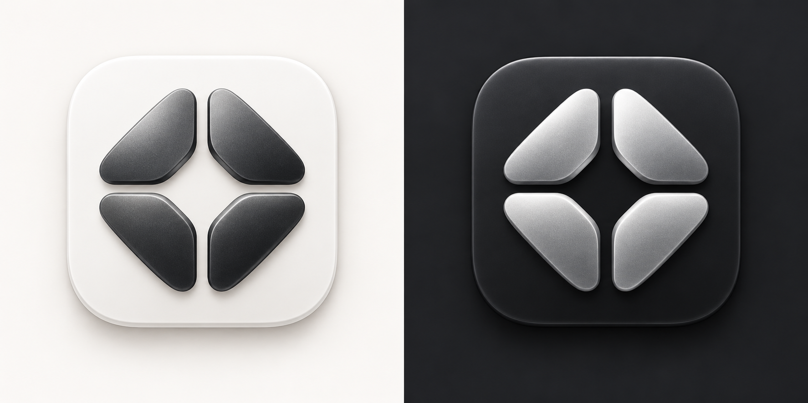
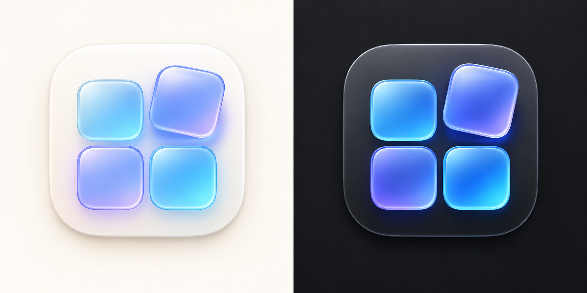
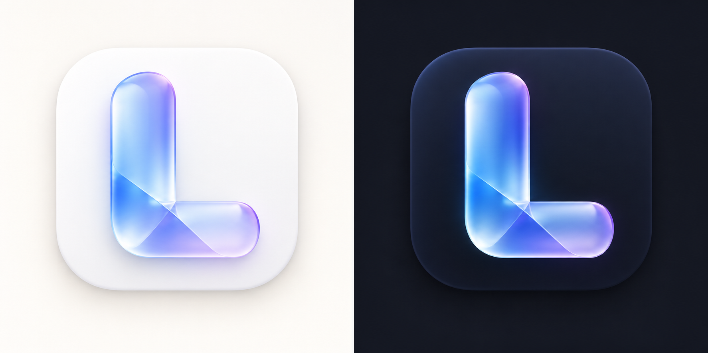
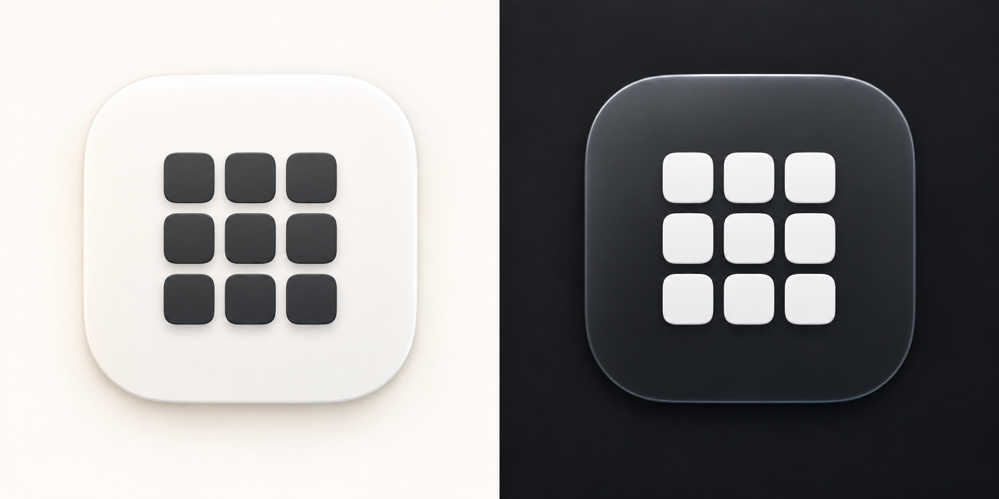

# Launch 图标候选稿

日期：2026-10-22。使用内置图像生成工具制作，均为原创方向。每张为左右配对的概念展示图：左为浅色，右为深色。展示图不直接打包，另行提取透明底单图。

最终确认接入三套：**A 四瓣开合、B2 单色九宫格、B 蓝紫四格**。不是 A / B / C，折光 L 不接入。资源位于 `Sources/LaunchApp/AppIcons`，生产处理提示词见 [production-prompts.md](production-prompts.md)。

参考：只读查看用户归档的 LaunchOS AppIcon.icns，提取其白色圆角底板、深色简洁单元、小尺寸识别的设计特点；未复制参考素材到项目。候选图独立生成。

| 方案 | 方向 | 浅深色处理 |
| --- | --- | --- |
| A 四瓣开合 | 四个实心几何瓣围出中央留白，延续简洁工具感 | 浅底深瓣 / 深底银瓣，保持形状一致 |
| B 悬浮应用格 | 2×2 蓝紫玻璃方块，右上格抬起，表达启动 | 浅底淡玻璃 / 石墨底饱和蓝紫，强化边缘 |
| B2 单色九宫格 | 按用户提供的九宫格参考重新设计，规整的 3×3 实心圆角方块，取消倾斜、彩色及悬浮 | 白底深灰格 / 石墨底白格 |
| C 折光 L | 折叠玻璃带构成 L，作为独立品牌标记 | 白瓷底 / 深蓝底，保留高对比玻璃带 |

## B2：按用户九宫格参考调整

保留 B 和 B2，两套同时提供，不互相替代。

三套各提供浅、深色透明主图；设置支持跟随系统、固定浅色、固定深色。默认安装图标为浅色九宫格，运行时选择不改写应用包。概念源提示词保存在 prompts.md。

