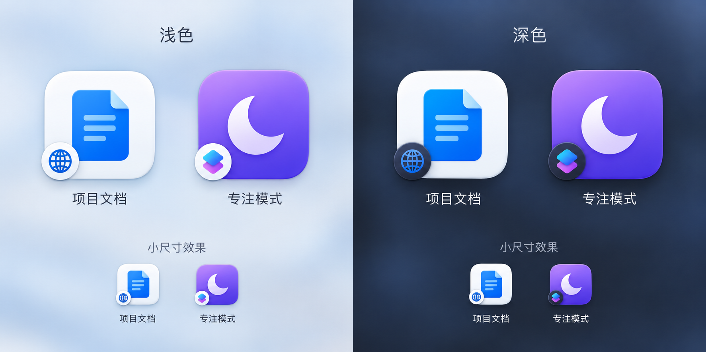

# 非应用条目：快捷指令、网址、文件夹、系统设置（设计草稿）

状态：2026-10-23 用户已批准首批实施计划，网址与快捷指令正在实现；访达文件夹与系统设置面板留待后续。实施约定与任务进度见 [首批计划](../plans/2026-10-23-extra-items-phase-one.md)，不把部分完成视为整项功能已交付。

## 1. 目标

除应用外，启动器还能搜索和打开四类条目：快捷指令、网址、访达文件夹、系统设置面板。

## 2. 已确认决策（用户 2026-10-23）

1. **出现位置**：四类条目都能在搜索框里搜到并打开。网格只放用户手动添加的条目，添加后和应用一样可拖动、放进文件夹、隐藏；不自动铺进网格。
2. **网址与文件夹的添加入口**：
   - 启动器空白处右键「添加网址…」「添加文件夹…」，填名称和网址或选文件夹，放在右键所在的那一页；右键条目可编辑、删除。
   - 设置窗口新增一页（暂名「条目」），以列表增删改网址和文件夹。
3. **网址图标**：添加或修改网址时访问一次该网站，优先取高清触屏图标（apple-touch-icon），存到本地后不再联网；取不到或太模糊时用首字图标。
4. **快捷指令图标**：默认用名称首字加底色生成图标，左下角叠小的快捷指令标记；**用户也可以自己设置图标**。原草稿的右下角位置已被用户的新决定替代。
5. **优先级**：优先实现网址和快捷指令；访达文件夹、系统设置面板仍保留在最终范围内。
6. **类型角标（预览已确认）**：网址与快捷指令均在主图标左下角加圆形类型角标，网址为地球，快捷指令为叠层标记。主图标仍显示网站图标或快捷指令默认/自定义图片，不用类型图标替代。浅色圆底、深色圆底分别适配，位置和比例一致；用户确认当前预览大小合适，以预览为视觉依据（包含圆底的外径约为主图标宽度的三分之一，轻微伸出边缘），实现时再按实际网格尺寸核对可读性。此次只确认网址与快捷指令的角标，其余类型的具体符号尚未确认。

### 已确认的视觉预览

预览中的「项目文档」与「专注模式」仅为示例，不代表读取或运行了用户的网址或快捷指令。生成方式与提示词见 [预览说明](../../../design/extra-items-2026-10-23/README.md)。角标方案已确认，不表示下文技术路线或其余待定问题已批准，也不表示功能已实现。

## 3. 本机证据（macOS 26.6.1）

### 快捷指令
- 系统自带 `/usr/bin/shortcuts`：`shortcuts list` 列出 26 个，`--show-identifiers` 带 UUID，`--folders` 列出文件夹；运行用 `shortcuts run <名称或 UUID>`。
- 不少指令是 iPhone 同步来的（如「4G5G 网络切换」「闪灯鸣笛」），在 Mac 上未必能运行。
- 没有公开接口获取每个指令的图标和颜色。

### 系统设置面板
- 位置：`/System/Library/ExtensionKit/Extensions/*.appex`，筛选 Info.plist 中 `EXAppExtensionAttributes.EXExtensionPointIdentifier` 以 `com.apple.Settings.extension.ui` 开头的，共 51 个（蓝牙、显示器、触控板、网络……）。
- 打开：`x-apple.systempreferences:<CFBundleIdentifier>`，前提是 `SettingsExtensionAttributes.allowsXAppleSystemPreferencesURLScheme` 为 1。
- 中文名：`Contents/Resources/InfoPlist.loctable` 的 `zh_CN.CFBundleDisplayName`（如「蓝牙」）。命令行脚本里用 `Bundle.localizedInfoDictionary` 只拿到英文，Launch 内是否能直接取中文待验证，稳妥做法是直接读 loctable。
- 图标：`NSWorkspace.shared.icon(forFile: appex 路径)` 能拿到原生图标（1024px，蓝牙为蓝色蓝牙图标）。
- 搜索词：`SettingsExtensionAttributes.searchTermsFileName` 指向 `<语言>.lproj/<名称>.searchTerms`（plist），内含子项标题与中文关键词。例如蓝牙的「蓝牙设备」关键词含「配对、耳机、鼠标、键盘」，可让搜「耳机」找到蓝牙。

### 网址与文件夹
- 由用户添加。网站图标需要联网取一次（见决策 3）。文件夹用系统图标，点击在访达中打开。

## 4. 现有代码约束

- `LayoutSlot` 只有 `app` / `folder` / `empty`；`LayoutFolder.apps` 是 `[AppIdentity]`；`AppIdentity` 对应一个 .app（bundleIdentifier 或路径）。
- 搜索（`SearchService`）、显示排序（`DisplaySorter`）、按类型分组（`AppCategory`）、图标（`IconCache` / `ApplicationIconResolver`）都以 `CatalogApp` 为单位。
- 多处假定条目是真实的 .app：卸载、在访达中显示、显示简介、添加日期与上次使用排序、类别分组、运行中退出等。

## 5. 技术路线与首批范围

- **A. 通用条目标识**：把 `AppIdentity` 泛化为条目标识（应用 / 快捷指令 / 网址 / 文件夹 / 设置面板），布局文件升到 schemaVersion 2。结构清晰，但布局编辑、拖动、多选、菜单、排序都要改。
- **B. 包装成虚拟应用**：条目用特殊路径（如 `launch-item:<id>`）当作 `AppIdentity` 注入目录，复用拖动、文件夹、隐藏、多选；在打开、图标、菜单、卸载、排序、分组处按类型分支。改动较小，但要逐处排除依赖 .app 的功能，且布局文件里混入非路径的标识。
- 已核对布局、菜单与搜索中的应用专属假设，用户同意首批计划，采用 A：`ItemIdentity` / `LaunchItem` 与布局 v2；`CatalogApp` / `AppIdentity` 继续只表示真实应用。B 不采用，原先“倾向 B”的草稿记录不再作为实施依据。
- 首批的搜索、运行、失效处理、图标、固定与备份默认选择，以已批准计划的“本阶段默认选择”为准；下列问题涉及首批的部分已由计划落实，其余类型仍待后续定稿。

## 6. 待定问题（下次继续）

1. 自定义图标：入口（右键「更换图标…」选图片？）、存储位置（如 `~/Library/Application Support/Launch/Icons`）、是否网址也能自定义。
2. 搜索结果：应用与其他条目如何混排；网址与快捷指令的左下角图形类型标记已确认，其余类型的标记及是否还需类型文字待定。
3. 快捷指令运行方式：`shortcuts run` 后台运行，还是 `shortcuts://run-shortcut?name=` 交给快捷指令 App；运行失败的提示。实测要先经用户同意，挑一个无副作用的指令（现有指令里「设定音量」「闪灯」等有副作用）。
4. 设置面板子项：搜索结果只显示面板（关键词匹配到面板），还是把「蓝牙设备」这类子项也作为单独结果。
5. 条目失效：指令被删、文件夹被移走、面板不存在时，是否按「未安装应用」的规则保留位置不显示。
6. 搜索结果加入网格：右键「添加到网格」放到哪一页、哪个位置。
7. 右键菜单：非应用条目显示哪些项（打开、编辑、删除、隐藏、更换图标），隐藏卸载、显示简介等应用专属项。
8. 排序方式、整理布局、按类型分组对非应用条目如何处理。
9. 布局导出、导入与备份要带上这些条目；旧版本 Launch 读到新布局文件时的兼容。
